# Final Design and Operating Flow

## Design status

This is the final target design for the Sales Genie Agent repository. The local implementation is
complete, but the Agent is **not deployment-ready** while workspace values, physical metadata,
business definitions, approvals, and workspace evaluation evidence remain unresolved.

Native Databricks Declarative Automation Bundles (DABs) are the primary deployment mechanism. The
Python SDK utilities support inspection, conversations, result retrieval, smoke tests, export/import,
and an explicitly legacy `deploy-dev`/`deploy-prod` lifecycle utility; none of them is the normal
deployment path. Those utilities call the official `WorkspaceClient.genie` methods, so authentication,
polling, and request shapes stay owned by the SDK.

## End-to-end architecture

```mermaid
flowchart LR
    A[Business owners and data stewards] --> B[Source-controlled configuration]
    B --> C[Local validation and tests]
    C --> D[Deterministic serialized-space v2 builder]
    D --> E[generated/target/sales_genie.geniespace.json]
    E --> F[Native DAB direct-engine resource]
    F --> G[Development Genie Agent]
    G --> H[Smoke tests and business evaluation]
    H --> I{Promotion approved?}
    I -- No --> B
    I -- Yes --> J[Back up current production Agent]
    J --> K[Production DAB deployment]
    K --> L[Post-deployment smoke test and export]
    L --> M[Monitor and fix only when required]
    L -- Failure --> N[Approved restore or clone from backup]
```



The design deliberately separates the files people author from the generated Databricks payload and
the deployed workspace object:

```text
Environment mapping
  + data contract and approved semantics
  + structured SQL expressions and examples
  + minimal global instructions
  + sample questions
  + explicitly promoted benchmarks
        |
        v
local validation -> serialized_space v2 -> native DAB -> workspace Genie Agent
                                                |
                                                v
                                  conversations, evaluation, export
```

## Component responsibilities

| Layer | Files | Responsibility |
|---|---|---|
| Environment | `config/environments/dev.yml`, `prod.yml` | Resolve workspace, warehouse, catalog, schema, source, identity, principal, and Agent settings independently for each target. |
| Data contract | `config/data/tables.yml` | Own exactly one logical `sales_fact` source, its type (`table` or `metric_view`), and the `fqn_template` used to build its fully qualified identifier from environment values. |
| Semantic context | `config/data/semantics.yml` | Define approved columns, descriptions, synonyms, grain, measures, classifications, and prompt-matching controls for the single source. |
| Structured teaching | `config/examples/` | Supply sample questions, SQL expressions, verified example SQL, and optional approved UC functions. |
| Global behaviour | `config/instructions/` | Hold only concise cross-query behaviour that cannot be represented structurally, plus its governance justification. |
| Independent evaluation | `evaluations/sales_questions.yml` | Test business interpretation, SQL/result characteristics, clarification, refusal, and security behaviour without teaching-set leakage. |
| Build and checks | `src/sales_genie/` and `tests/` | Validate configuration, resolve the target-specific source, build deterministic payloads, and enforce deployment gates. |
| Deployment | `databricks.yml` and `resources/` | Deploy the generated Agent through native `resources.genie_spaces` with `bundle.engine: direct`. |
| Generated output | `generated/<target>/sales_genie.geniespace.json` | Environment-specific serialized-space version 2 payload; generated and ignored by Git. |
| Operations | `docs/`, CLI commands, and CI workflow | Define readiness, permissions, smoke testing, promotion, backup, and rollback. |

## Mandatory and optional project inputs

“Mandatory” below means required by this repository's quality and deployment gates. It is stricter
than the smallest payload the Databricks API might accept.

| Area | Status | Rule |
|---|---|---|
| `databricks.yml` and `resources/sales_genie.genie_space.yml` | Mandatory | Primary native DAB deployment definition. |
| Both environment files | Mandatory | Dev and prod mappings must remain separate; real values are required only for the target being deployed. |
| `tables.yml` and `semantics.yml` | Mandatory | Required for single-source resolution, typed serialization, descriptions, grain, classifications, approvals, and validation. `tables.yml` is authoritative and declares exactly one source, its `source_type` (`table` or `metric_view`), and template. This repository attaches existing Metric Views but does not create them. |
| `general_instructions.md` | Mandatory | Must stay concise and contain only truly global behaviour. |
| `text_instruction_justification.md` | Mandatory governance record | Explains why each free-text rule cannot be structured and how it will be reviewed. |
| `sample_questions.yml` | Mandatory | Provides approved user-visible starting questions. |
| `sql_examples.yml` | Mandatory for this project | Deployment requires at least one example; beyond that, examples must cover distinct, useful query shapes and be executed or explained, reviewed, and approved. There is no arbitrary quota gate. |
| `sql_expressions.yml` | Optional until approved expressions exist | Preferred location for reusable measures, filters, and dimensions; empty content is valid. |
| `sql_functions.yml` | Optional | Keep empty until a function is genuinely required, approved, granted `EXECUTE`, and the current serialized schema is confirmed. |
| Customer and sales-target attributes | Optional | Use only when approved questions require them and the columns exist in the single source. |
| Evaluation cases | Mandatory for promotion | Local definitions may remain pending, but production requires approved expectations and passed workspace evidence. |
| Generated files, state, exports, backups | Runtime artifacts | Created per environment and excluded from source control; they are not hand-authored inputs. |

## Authoring and local-validation flow

1. Confirm the Agent's audience, narrow purpose, supported questions, and evaluation mode in
   `docs/readiness-and-decisions.md`.
2. Map development and production independently. This project promotes the source by changing only its
   catalog component: schema, object name, and source type must remain identical. Agent IDs, state
   files, generated artifacts, and bundle target state remain environment-specific; other workspace
   infrastructure may be shared when that is the approved topology.
3. Complete the Metric View decision. KPI-heavy sales analysis should prefer a governed Metric View;
   using the raw denormalized table requires an approved reason and verified grain.
4. Update the data contract and semantics from Unity Catalog evidence. Do not invent fields,
   formulas, fiscal rules, or currency logic.
5. Put reusable metric/filter/dimension logic in SQL expressions, representative query shapes in SQL
   examples, and only irreducible global behaviour in general instructions. When the source is a
   Metric View, examples must follow `MEASURE()` query rules and must not re-derive governed measures.
6. Keep sample questions and teaching SQL separate from the independent evaluation suite.
7. Run local checks:

   ```bash
   sales-genie validate-config --config config/environments/dev.yml
   sales-genie validate-config --config config/environments/prod.yml
   sales-genie compare-dev-prod
   sales-genie generate-bundle --config config/environments/dev.yml
   sales-genie generate-bundle --config config/environments/prod.yml
   pytest
   ruff check .
   ```

Local checks intentionally allow labelled placeholders. Adding `--deployment` activates strict gates
and must fail until the selected target contains real, approved, verified values.

## Workspace readiness and development flow

After a workspace becomes available:

1. Authenticate with Databricks unified authentication and an explicit development profile. Do not
   implement token acquisition in project code.
2. Verify the SQL warehouse, single Unity Catalog object, required columns, types, privileges, row filters,
   masks, source freshness, grain, keys, and duplicate-row behavior.
3. Execute or `EXPLAIN` every teaching query in the intended warehouse and record business and
   technical approval.
4. Confirm prompt matching is enabled only for eligible stable string dimensions. It must not bypass
   Unity Catalog access controls.
5. Generate the strict development artifact and use the native bundle:

   ```bash
   sales-genie validate-config --config config/environments/dev.yml --deployment
   sales-genie generate-bundle --config config/environments/dev.yml --deployment
   databricks bundle validate --strict --target dev --profile <dev-profile>
   databricks bundle deploy --target dev --profile <dev-profile>
   ```

6. Resolve the deployed Agent ID from `databricks bundle summary`, then run smoke tests, conversation
   tests, follow-ups, generated-SQL review, result review, and export.
7. Run the 21-case independent evaluation suite. Use verified answer SQL for deterministic Chat-mode
   benchmarks and evaluation notes for Agent-mode synthesis. Record evidence; do not fabricate
   expected values.

## Promotion and production flow

Production is a manual, event-driven release: one initial deployment and only approved fixes or
enhancements afterward. There is no weekly schedule.

Promotion requires all of the following:

- No unresolved placeholders in the production target.
- Approved source, semantics, examples, instructions, and evaluation expectations.
- Passing local lint, tests, validation, environment-isolation checks, and secret scan.
- Passing development smoke tests and business evaluation with recorded evidence.
- The production source identifier uses the production catalog while preserving the approved schema,
  object name, and table-versus-Metric-View type from development.
- Production has its own Agent identity, state, generated artifact, approval, and permissions;
  workspace infrastructure follows the approved environment topology.
- Protected production-environment approval.
- Export of the existing production Agent before an update.

The release sequence is:

```bash
sales-genie validate-config --config config/environments/prod.yml --deployment
sales-genie generate-bundle --config config/environments/prod.yml --deployment
sales-genie export-agent --config config/environments/prod.yml \
  --agent-id <current-prod-agent-id> --output backups/prod-before-deploy.json
databricks bundle validate --strict --target prod --profile <prod-profile>
databricks bundle deploy --target prod --profile <prod-profile>
sales-genie run-smoke-tests --config config/environments/prod.yml \
  --agent-id <deployed-prod-agent-id>
sales-genie export-agent --config config/environments/prod.yml \
  --agent-id <deployed-prod-agent-id> --output exports/prod-agent.json
```

The backup command is applicable to updates; the first deployment has no prior Agent to export.

## Security and permission flow

Unity Catalog and workspace permissions are the security boundary. Instructions are not access
control. Apply least privilege to:

- The deployment identity for the target workspace folder and managed Agent.
- The applicable querying identity or user for `CAN USE` on the SQL warehouse.
- `USE CATALOG`, `USE SCHEMA`, and `SELECT` only on approved data objects.
- `EXECUTE` only on specifically approved Unity Catalog functions.
- End-user `CAN RUN` access on the Agent.

Use curated views, row filters, and column masks for sensitive data. Do not broadly enable entity
matching on protected, dynamic, free-text, identifier, or numeric fields.

## Failure and rollback flow

If strict validation fails, stop before deployment and correct the source configuration. If a
post-deployment test fails:

1. Stop promotion or user rollout.
2. Preserve the failed deployment export, logs, generated SQL, and test evidence.
3. Review `backups/prod-before-deploy.json` and confirm it belongs to production.
4. Restore the reviewed definition only through an explicitly approved update, or import it as a
   clone when preserving the failed Agent is safer.
5. Reapply and verify permissions because definition restoration is not a substitute for permission
   validation.
6. Repeat smoke tests and the affected evaluation cases before reopening access.

Clone/import validates that the source type, schema, and object name match the target configuration,
then remaps the complete source identifier and embedded SQL from the exported catalog to the target
catalog. Any source-shape drift blocks the import, as does a payload with zero or multiple sources.

The detailed operational procedure is in
[`deployment-and-rollback.md`](deployment-and-rollback.md).

## Current readiness

| Area | Current state |
|---|---|
| Repository design, local serializer, native DAB definition, tests, and CI template | Implemented |
| Workspace authentication and API activity | Not performed |
| Physical catalog, schema, table/view/Metric View, columns, and keys | Placeholders; must be verified |
| Metric View decision and KPI formulas | Pending business/data-owner approval |
| SQL examples | Five distinct placeholder examples; untested and pending approval |
| SQL expressions and UC functions | Empty until approved use cases and schema evidence exist |
| Workspace smoke tests and evaluation evidence | Pending a development workspace |
| Production deployment | Blocked by the preceding readiness gates |

The authoritative single-source definition and verification date are maintained in the root
[`README.md`](../README.md#verified-databricks-references).
